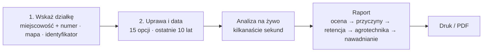
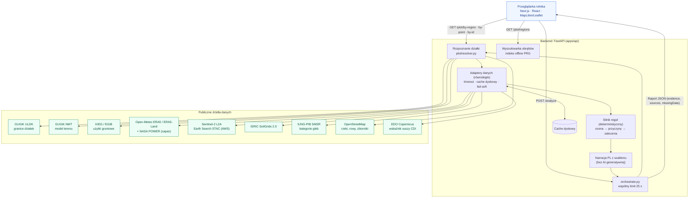

<div align="center">

# Retencja

### Zatrzymaj wodę na swojej działce

**HACKNATION 2026 · zadanie KOWR „Zatrzymaj wodę, chroń plony – Inteligentne wsparcie gospodarowania wodą w rolnictwie”**


</div>

| | |
|---|---|
| **Zespół** | [UZUPEŁNIJ: Nazwa Zespołu] |
| **Film prezentacyjny (≤ 3 min)** | [UZUPEŁNIJ: Link do wideo do 3 min] |
| **Prezentacja PDF (≤ 10 slajdów)** | [UZUPEŁNIJ: Link lub ścieżka do prezentacji PDF] |
| **Przykładowy raport z prototypu** | surowy wynik `/analyze` z prawdziwego uruchomienia: [`fixtures/evidence_sample.json`](fixtures/evidence_sample.json) |

> [!IMPORTANT]
> **Ocena i rekomendacje są obliczane przez aplikację na żywo** z publicznych danych, dla dowolnej działki ewidencyjnej w Polsce i dowolnej daty z ostatnich 10 lat. Aplikacja nie zawiera gotowych raportów ani wyników dla wybranych działek.

### Dla jury: uruchomienie w 3 krokach

1. Uruchom **`start.bat`** (Windows) albo **`./start.sh`** (Linux / macOS). Wymagane: Python 3.11+ i Node.js 20.9+.
2. Otwórz **http://localhost:3000** i kliknij **„Sprawdź działkę”**.
3. Wskaż działkę jednym z trzech sposobów (miejscowość + numer, kliknięcie na mapie albo pełny identyfikator, np. `040308_5.0004.17220`), wybierz uprawę z listy 15 i datę, a potem kliknij **„Przygotuj raport wodny”**. Raport pojawi się po kilkunastu sekundach.

Szczegóły i wariant ręczny: [Instrukcja uruchomienia](#instrukcja-uruchomienia). Opis wszystkich funkcji: [Funkcjonalności](#funkcjonalności).

---

## Spis treści

1. [O projekcie](#o-projekcie)
2. [Funkcjonalności](#funkcjonalności)
3. [Instrukcja uruchomienia](#instrukcja-uruchomienia)
4. [Architektura](#architektura)
5. [Źródła danych: live vs. przygotowane wcześniej](#źródła-danych-live-vs-przygotowane-wcześniej)
6. [Technologie, biblioteki i AI](#technologie-biblioteki-i-ai)
7. [Licencje i warunki korzystania](#licencje-i-warunki-korzystania)
8. [Znane ograniczenia i niepewność](#znane-ograniczenia-i-niepewność)
9. [Weryfikacja, skalowalność i bezpieczeństwo](#weryfikacja-skalowalność-i-bezpieczeństwo)
10. [Struktura repozytorium](#struktura-repozytorium)

---

## O projekcie

### Problem
Dane o suszy, glebie, pogodzie i terenie są publiczne, ale rozproszone po kilkunastu serwisach (GUGiK, IUNG, Copernicus, ISRIC…) i wymagają wiedzy GIS. Rolnik nie dostaje z nich prostej odpowiedzi na pytanie: *„czy na mojej działce brakuje wody, dlaczego i co mam zrobić?”*.

### Rozwiązanie
**Retencja** to aplikacja webowa uruchamiana w przeglądarce. Rolnik wskazuje działkę ewidencyjną, wybiera uprawę i datę analizy (dziś lub dowolny dzień z ostatnich 10 lat). Aplikacja pobiera dane z publicznych serwisów dla tej konkretnej działki i w kilkanaście sekund liczy raport wodny.

### Sposób wykorzystania danych
Dane z 5 kategorii (meteorologia, satelita, gleba, hydrologia, dane przestrzenne) są pobierane równolegle, a deterministyczny silnik reguł łączy je w ocenę. Metody opierają się na uznanych źródłach naukowych i prawnych:
- progi suszy rolniczej IUNG-PIB / MRiRW (Dz.U. 2019 poz. 739),
- klimatyczny bilans wodny (opad − ewapotranspiracja ET0, FAO-56),
- pojemność wodna gleby (Saxton & Rawls 2006),
- spływ powierzchniowy (SCS Curve Number, USDA),
- wrażliwość upraw na suszę (FAO-33).

Każda liczba w raporcie ma identyfikator dowodu (`evidence`) wskazujący jej źródło.

### Korzyści dla rolnika

| | |
|---|---|
| **Konkretne działania** | gdzie na działce zrobić oczko wodne (najniższy punkt z modelu terenu, zaznaczony na mapie), jak duże powinno być, czy pobliski rów nadaje się do zastawki, jakie zabiegi zatrzymają wodę w glebie |
| **Najpierw retencja** | nawadnianie jest na końcu i tylko gdy ma sens: woda zatrzymana na polu jest najtańsza |
| **Uczciwość** | raport zawsze pokazuje źródła, datę danych, poziom pewności i to, czego brakuje |
| **Zero barier** | bez konta, bez instalacji, bez wiedzy GIS, po polsku; wydruk lub PDF jednym kliknięciem |

---

## Funkcjonalności

Cała ścieżka rolnika to trzy kroki na stronie **„Sprawdź działkę”** i jeden raport:



### 1. Wskazanie działki: trzy sposoby

| Sposób | Jak działa | Przykład |
|---|---|---|
| **Miejscowość + numer działki** (domyślny) | Rolnik zaczyna pisać nazwę wsi lub gminy, a lista pasujących obrębów pojawia się na bieżąco. Po wybraniu miejscowości mapa sama się do niej przybliża, a rolnik wpisuje numer działki z wypisu z rejestru gruntów. | „przylubie” → 2 miejscowości → wybór *Przyłubie, gm. Solec Kujawski* → numer `17220` |
| **Kliknięcie na mapie** | Gdy mapa jest oddalona, kliknięcie ją przybliża. Po przybliżeniu kliknięcie wybiera działkę, w której leży punkt. | dla rolnika, który nie zna numeru działki |
| **Pełny identyfikator działki** | Rozwijane pole „Mam pełny identyfikator działki”, w formacie TERYT z wypisu. | `040308_5.0004.17220` |

**Wyszukiwarka miejscowości** działa offline na indeksie wszystkich obrębów w Polsce (PRG GUGiK), więc odpowiada natychmiast:
- polskie znaki nie są potrzebne („lodz” znajdzie „Łódź”),
- wystarczy początek nazwy („zdzil” znajdzie wszystkie Zdziłowice, także „Zdziłowice Pierwsze/Drugie”),
- można szukać po nazwie gminy (wszystkie obręby gminy),
- przy wielu wynikach można zawęzić po przecinku gminą lub powiatem, np. `Przyłubie, Solec Kujawski` (z 2 wyników zostaje 1),
- w miastach obręby mają numery zamiast nazw dzielnic, np. „Warszawa 1-01-01”, „Kraków K-12”,
- gdy jest jedno dokładne trafienie, miejscowość wybiera się sama; lista pokazuje do 100 wyników z gminą, powiatem i województwem.

Numer działki można wpisać z ukośnikiem (`134/2`). Gdy działki nie ma w danym obrębie, aplikacja mówi to wprost.

**Mapa** ([`MapPicker.tsx`](apps/web/components/MapPicker.tsx)):
- przełącznik **„Mapa” / „Zdjęcie lotnicze”** (ortofotomapa Geoportalu, od przybliżenia 15 w wysokiej rozdzielczości),
- **granice i numery działek** z Krajowej Integracji Ewidencji Gruntów, widoczne po przybliżeniu,
- przycisk **„Moja lokalizacja”** (geolokalizacja przeglądarki, tylko do przesunięcia mapy),
- podpowiedzi na mapie („Przybliż mapę do swojej miejscowości”, „Kliknij swoją działkę”), skala, przybliżanie i oddalanie,
- własna mapa wektorowa (OpenFreeMap) w kolorach motywu aplikacji; na słabszych urządzeniach bez WebGL2 mapa sama przełącza się na zwykłe kafle OpenStreetMap.

Po wybraniu działki panel pokazuje **kartę działki** (numer, powierzchnia, gmina i województwo) z przyciskiem „Zmień”, a mapa obrysowuje działkę.

### 2. Uprawa i data analizy

**Uprawa** jest wybierana z listy 15 pozycji: 14 grup upraw z systemu monitoringu suszy rolniczej IUNG (SMSR) oraz „Brak uprawy”.

| Grupa | Uprawy do wyboru |
|---|---|
| Zboża | Zboża ozime · Zboża jare |
| Kukurydza | Kukurydza na ziarno · Kukurydza na kiszonkę |
| Okopowe i przemysłowe | Ziemniak · Burak cukrowy · Rzepak i rzepik · Tytoń · Chmiel |
| Warzywa i strączkowe | Warzywa gruntowe · Rośliny strączkowe |
| Sady i plantacje | Drzewa owocowe · Krzewy owocowe · Truskawki |
| Bez uprawy | Brak uprawy (pole puste, ugór, nic nie zasiane) |

Wybrana uprawa zmienia obliczenia:
- **próg suszy rolniczej** z rozporządzenia MRiRW zależy od uprawy i kategorii gleby,
- **wrażliwość na suszę** pochodzi z FAO-33 (Ky); dla rzepaku, tytoniu, chmielu, drzew i krzewów owocowych oraz truskawek, których nie ma w tabeli FAO, użyto wartości orientacyjnych oznaczonych w raporcie jako „przyjęte”,
- **sezon wzrostu i faza krytyczna** decydują o nawadnianiu (np. kukurydza: sezon V–IX, najwrażliwsza w lipcu i sierpniu),
- **oczekiwany NDVI dla uprawy i miesiąca** decyduje, jak czytać zdjęcie satelitarne,
- **pokrycie terenu** zmienia obliczenie spływu (Curve Number).

Dla upraw wieloletnich (chmiel, drzewa i krzewy owocowe, truskawki) aplikacja nie proponuje orki ani międzyplonów. Dla „Brak uprawy” nie proponuje nawadniania, a okres ryzyka pokazuje jako najbardziej suche miesiące. Gdy rozporządzenie nie przewiduje uprawy na danej glebie (np. burak cukrowy na glebie kategorii I), raport o tym ostrzega.

**Data analizy:** domyślnie dzisiaj, do wyboru dowolny dzień z ostatnich 10 lat. Zakres sprawdza zarówno formularz, jak i API, więc data z przyszłości lub sprzed 10 lat jest odrzucana z komunikatem.

### 3. Analiza na żywo
Po kliknięciu **„Przygotuj raport wodny”** pojawia się ekran postępu z pięcioma etapami (pobieranie danych → ocena wilgotności → przyczyny → retencja i agrotechnika → nawadnianie) i licznikiem czasu. Po 30 s pokazuje się informacja, że któryś serwis odpowiada wolniej. Gdy analiza przekroczy 60 s albo serwer nie odpowiada, formularz wraca z polskim komunikatem i przyciskiem „Spróbuj ponownie”. Jeśli serwer analizy jest niedostępny już przy wejściu na stronę, aplikacja od razu to pokazuje.

### 4. Raport wodny
Raport ma stałą kolejność wymaganą przez KOWR. Rekomendacje nie powstają bez wcześniejszej oceny działki: bez niej silnik zgłasza błąd ([`rank.py`](apps/api/app/engine/rank.py)).

| Część raportu | Co zawiera |
|---|---|
| **Nagłówek** | numer działki, gmina, powiat, województwo; przyciski „Drukuj / zapisz PDF” i „Sprawdź inną działkę” |
| **Ostrzeżenia** | „Raport niepełny” z listą braków i linkiem do szczegółów; „Sprawdź rodzaj użytku”, gdy według ewidencji działka nie jest polem (np. łąka, las) albo wybrana uprawa do niej nie pasuje |
| **Metryczka** | uprawa, **rodzaj użytku z ewidencji gruntów (EGiB)** z klasą bonitacyjną i kodem (np. `RIIIa`), data oceny, powierzchnia, spadek terenu, data utworzenia raportu |
| **W skrócie** | stan teraz, podatność wieloletnia, kiedy najczęściej brakuje wody (np. „21.V–20.VII, w 6 z 10 lat”) i **„Co zrobić najpierw”**: do 4 najważniejszych działań z kosztem i terminem |
| **Mapa działki** | obrys działki i **sugerowane miejsce retencji** (najniższy punkt z modelu terenu) z legendą: różnica wysokości na działce, ostrzeżenie, gdy punkt leży przy granicy, dokładność; obok spis treści raportu |
| **1. Ocena wilgotności** | dwie karty: **„Teraz”** (skala: Bardzo sucho / Sucho / W normie / Mokro) i **„Przez ostatnie lata”** (podatność: Niska / Średnia / Wysoka), każda z opisem, poziomem pewności i rozwijanym „Na jakiej podstawie?”; wykres **„Kiedy na tej działce najczęściej brakuje wody”**; rozwijany wykres **„Opady miesiąc po miesiącu”** |
| **2. Możliwe przyczyny** | od najpewniejszych: za mało deszczu · gleba słabo trzyma wodę · część deszczu spływa z pola · uprawa potrzebuje dużo wody · pole stoi bez okrywy roślinnej; każda z poziomem pewności i dowodami |
| **3. Zatrzymaj wodę na polu** | działania retencyjne w kolejności ważności |
| **4. Zmiany w uprawie gleby** | działania agrotechniczne w kolejności ważności |
| **5. Nawadnianie** | konkretny plan albo wyjaśnienie, dlaczego nawadnianie nie ma teraz sensu |
| **Czego brakuje + Źródła danych i ograniczenia** | lista braków („czego brakuje, dlaczego, co to zmienia”); rozwijana tabela źródeł (dostawca z linkiem, licencja, status, pobrane teraz / z pamięci podręcznej, okres danych, moment pobrania); lista ograniczeń; identyfikator raportu |

**Wykresy:**
- **„Kiedy na tej działce najczęściej brakuje wody”** ma 14 słupków, po jednym dla każdego 60-dniowego okresu monitoringu suszy IUNG. Wysokość słupka to liczba lat z ostatnich 10, w których bilans wodny spadł poniżej progu suszy dla tej uprawy i gleby. Wyróżnione są okresy ryzyka (co najmniej 3 lata na 10) i najbardziej wrażliwa faza uprawy. Gdy dla uprawy lub gleby nie ma progu IUNG, wykres pokazuje miesiące, w których parowanie najbardziej przewyższa opady.
- **„Opady miesiąc po miesiącu”** pokazuje 12 ostatnich miesięcy na tle średniej z tych samych dni w poprzednich latach, z sumą i procentem normy.

Oba wykresy mają podpowiedzi po najechaniu i ukryte tabele dla czytników ekranu.

**Karta zalecenia** zawiera: numer kolejności, nazwę, termin („kiedy”), koszt (niski / średni / wyższy), opis działania, uzasadnienie dla tej konkretnej działki zbudowane z jej danych oraz „Na jakiej podstawie?” z liczbami i źródłami. Prawdziwe uzasadnienia z przykładowego raportu (działka w Przyłubiu, kukurydza na ziarno):
- oczko: *„Według modelu terenu najniższe miejsce działki leży 9,8 m niżej niż najwyższe (zaznaczone na mapie)… oczko powinno mieć ok. 1090 m³ pojemności (np. ok. 727 m² przy głębokości 1,5 m)”*,
- resztki pożniwne: *„Resztki chronią glebę przed słońcem i wiatrem, więc mniej wody wyparowuje. To ważne na glebie z 72% piasku.”*,
- nawadnianie: *„Przez ostatnie 30 dni uprawie zabrakło ok. 120 litrów wody na każdy metr kwadratowy pola… jednorazowo 15–20 litrów wody na m²… na całą działkę (27,87 ha) ok. 4180–5570 m³… co 2–3 dni”*.

Inne działania mają uzasadnienia w tym samym stylu, np. pas zieleni podaje spadek działki i roczną objętość spływu, a zastawka na rowie podaje typ cieku i jego odległość od działki.

### 5. Jak dobierane są zalecenia
Działania pochodzą ze **stałego katalogu** ([`apps/api/app/actions/catalog.py`](apps/api/app/actions/catalog.py)), więc system nie może wymyślić zabiegu. O wyborze decydują przyczyny i warunki działki:

| Działanie | Pojawia się, gdy… | Nie pojawia się, gdy… | Koszt · termin |
|---|---|---|---|
| **Pas zieleni na dole pola** (`buffer_strips`) | woda spływa z pola (spadek terenu, ryzyko spływu) | działka to zabudowa, woda lub droga | niski · jesień lub wiosna |
| **Zatrzymaj wodę w rowie** (`ditch_retention`) | w promieniu 500 m jest rów lub drenaż (OpenStreetMap) | – | średni · przed zimą |
| **Małe oczko wodne lub zbiornik** (`small_pond`) | oczko ma naturalne uzasadnienie: na zdjęciu satelitarnym widać stojącą wodę albo działka ma co najmniej 0,3 ha i wyraźne obniżenie terenu (≥ 0,4 m), spadek ≥ 3,5% lub ryzyko spływu | działka to las, zabudowa, woda, droga albo grunt nierolniczy; działka poniżej 0,3 ha bez stojącej wody | wysoki · po zbiorach |
| **Międzyplon po zbiorach** (`cover_crops`) | gleba słabo trzyma wodę, woda spływa albo pole stoi bez okrywy | łąka, pastwisko, sad, las, siedlisko, uprawa wieloletnia | niski · sierpień–wrzesień |
| **Zostaw resztki pożniwne** (`residues`) | za mało deszczu, gleba słabo trzyma wodę albo pole stoi bez okrywy | łąka, pastwisko, las, grunt nierolniczy | niski · po zbiorach |
| **Mniej orki** (`reduce_tillage`) | gleba słabo trzyma wodę albo woda spływa | jak przy międzyplonie | średni · od następnego sezonu |
| **Podlewanie tylko w kluczowym momencie** (`irrigation_timing`) | teraz jest sucho **i** uprawa jest wrażliwa **i** trwa jej sezon **i** zaproponowano już działania retencyjne | brak uprawy, poza sezonem, uprawa odporna na suszę | wysoki · w okresie krytycznym |

Gdy grozi susza, a żadna reguła nie wskazała działania, raport zawsze proponuje co najmniej jedno działanie retencyjne i jedno agrotechniczne pasujące do rodzaju użytku. Gdy nie ma ani ryzyka suszy, ani przyczyn, raport mówi wprost, że dodatkowe działania nie są potrzebne.

**Plan nawadniania** podaje:
- ile wody zabrakło uprawie w ostatnich 30 dniach (ET0 × Kc wg FAO-56 minus opad),
- dawkę jednorazową w l/m², m³/ha i m³ na całą działkę (gleba lekka 15–20 mm, średnia i cięższa 25–30 mm),
- jak często podlewać (co ile dni, z dziennego zużycia wody przez uprawę),
- kiedy pominąć podlewanie po deszczu i kiedy skończyć.

### 6. Druk, zapis i wygoda
- **„Drukuj / zapisz PDF”** korzysta z dedykowanego stylu A4 ([`print.css`](apps/web/styles/print.css)): ukrywa menu i przyciski, rozwija wszystkie uzasadnienia, źródła i wykres opadów, a mapa drukuje się razem z raportem.
- Raport przetrwa odświeżenie strony (jest zapisany w karcie przeglądarki), ale nie jest wysyłany na żaden serwer.
- Motyw **jasny / ciemny** (domyślnie jasny), przełączany w nagłówku i zapamiętywany w przeglądarce.
- Układ dostosowuje się do telefonu i tabletu.
- Strona główna wyjaśnia, jak działa narzędzie, co zawiera raport i skąd pochodzą dane.
- Wszystkie komunikaty błędów są po polsku i mówią, co zrobić (np. „Nie znaleźliśmy tej działki: sprawdź numer na wypisie albo wskaż ją na mapie”).

### Przykładowy wynik z prawdziwego uruchomienia
Pomiar kontrolny z 2026-11-22: działka `040308_5.0004.17220` (Przyłubie, gm. Solec Kujawski), uprawa „Kukurydza na ziarno”, data analizy 2026-07-15.

| Element raportu | Wynik |
|---|---|
| Stan teraz | **Sucho** |
| Podatność wieloletnia | **Średnia** |
| Przyczyny | gleba słabo trzyma wodę, za mało deszczu, uprawa potrzebuje dużo wody |
| Retencja | małe oczko wodne lub zbiornik w najniższym punkcie działki, ok. 1090 m³ |
| Agrotechnika | międzyplon po zbiorach, resztki pożniwne, mniej orki |
| Nawadnianie | zalecone (sucho, uprawa wrażliwa, trwa faza krytyczna): 15–20 l/m² co 2–3 dni |
| Status raportu | **niepełny**: brak rodzaju użytku (EGiB), kategorii gleby IUNG (na mapie IUNG to las) i klasy suszy EDO |
| Czas obliczeń | 10,8 s |

> [!NOTE]
> Raport „niepełny” jest zamierzonym zachowaniem: gdy źródło nie ma danych dla działki, aplikacja mówi o tym wprost i liczy dalej na pozostałych danych. Wyniki mogą się nieznacznie różnić przy kolejnym uruchomieniu, bo dane źródłowe są pobierane na żywo.

---

## Instrukcja uruchomienia

> **Rolnik nie instaluje niczego:** korzysta z aplikacji w zwykłej przeglądarce (Chrome, Edge, Firefox, Safari, Opera, także na telefonie). Poniższa instrukcja dotyczy uruchomienia lokalnego, np. przez jurora.

### Wymagania wstępne

| Narzędzie | Wersja | Skąd |
|---|---|---|
| Python | **3.11+** | https://www.python.org/downloads/ (na Windows zaznacz *„Add python.exe to PATH”*) |
| Node.js (z npm) | **20.9+** | https://nodejs.org/ |
| Internet | – | dane są pobierane na żywo z publicznych API |

Klucze API nie są potrzebne. Wszystkie źródła danych są bezpłatne.

> [!TIP]
> Aplikację uruchomiono i przetestowano na Pythonie 3.14 (Linux). Jeśli na Windows instalacja paczek GIS (`rasterio`, `shapely`) zgłosi błąd na bardzo nowym Pythonie, użyj Pythona 3.12.

### Opcja A: jedno polecenie (zalecane)

| System | Polecenie (z katalogu głównego repozytorium) |
|---|---|
| **Windows** | dwuklik na **`start.bat`** (albo `start.bat` w CMD / PowerShell) |
| Linux / macOS / WSL | `./start.sh` (gdy brak uprawnień do uruchomienia, np. po pobraniu ZIP: `bash start.sh`) |

Skrypt sam:
1. sprawdza wersje Pythona i Node.js,
2. tworzy `apps/api/.env` i `apps/web/.env.local` z plików `.env.example`,
3. tworzy środowisko Python `apps/api/.venv` i instaluje zależności (pierwszy raz: kilka minut),
4. instaluje paczki npm,
5. wybiera wolne porty (domyślnie API **8000**, aplikacja **3000**; na Windows port 8000 bywa zablokowany przez Hyper-V, wtedy skrypt bierze następny wolny i pokazuje ostrzeżenie),
6. uruchamia API i aplikację oraz otwiera przeglądarkę (adres jest wypisany w oknie skryptu, domyślnie **http://localhost:3000**).

Logi: `api.log`, `web.log` (na Windows także `api.err.log`, `web.err.log`). Zatrzymanie: **Enter** w oknie skryptu (Windows) albo **Ctrl+C** (Linux/macOS).

### Opcja B: ręcznie (dwa terminale), gdy skrypt nie zadziała

**Terminal 1: API (FastAPI)**
```bash
cd apps/api
python -m venv .venv
.venv\Scripts\activate            # Windows  (Linux/macOS: source .venv/bin/activate)
pip install -r requirements.txt
copy .env.example .env            # Windows  (Linux/macOS: cp .env.example .env)
uvicorn app.main:app --port 8000
```

**Terminal 2: aplikacja (Next.js)**
```bash
cd apps/web
copy .env.example .env.local      # Windows  (Linux/macOS: cp .env.example .env.local)
npm install
npm run dev                       # http://localhost:3000
```

### Konfiguracja

| Zmienna | Gdzie ustawić | Domyślnie | Znaczenie |
|---|---|---|---|
| `NEXT_PUBLIC_API_URL` | `apps/web/.env.local` | `http://localhost:8000` | adres API dla przeglądarki (skrypty startowe ustawiają ją same, gdy zmieniają port) |
| `CORS_ORIGINS` | `apps/api/.env` | `http://localhost:3000,http://127.0.0.1:3000` | domeny, z których przeglądarka może pytać API |
| `DATA_BUDGET_S` | `apps/api/.env` (dopisz linię) | `25` | wspólny limit czasu (s) na pobranie wszystkich danych |
| `ADAPTER_CACHE_DIR` | **zmienna środowiskowa procesu** | `apps/api/cache` | katalog pamięci podręcznej odpowiedzi API |
| `OPEN_METEO_API_KEY` | **zmienna środowiskowa procesu** | *(puste)* | opcjonalny płatny klucz Open-Meteo do użytku komercyjnego |

> [!WARNING]
> `ADAPTER_CACHE_DIR` i `OPEN_METEO_API_KEY` **nie są czytane z pliku `.env`**, tylko ze środowiska procesu. Ustaw je przed uruchomieniem, np. `OPEN_METEO_API_KEY=... ./start.sh` (Linux/macOS) albo `$env:OPEN_METEO_API_KEY="..."; .\start.ps1` (PowerShell).

### Szybki test przez API
```bash
curl -X POST http://127.0.0.1:8000/analyze -H "Content-Type: application/json" -d "{\"plotId\":\"040308_5.0004.17220\",\"cropId\":\"kukurydza_ziarno\",\"analysisDate\":\"2026-07-15\"}"
```
Dokumentacja API (Swagger): http://localhost:8000/docs. Identyfikatory wszystkich upraw: `GET /crops` (np. `zboza_ozime`, `ziemniak`, `rzepak`, `brak`).

### Testy automatyczne
```bash
cd apps/api
python -m pytest -q        # 100 testów, offline (bez sieci)
```

---

## Architektura



Podkłady mapy w przeglądarce (OpenFreeMap, ortofotomapa Geoportalu, granice działek KIEG, OpenStreetMap) są pobierane przez przeglądarkę bezpośrednio z tych serwisów, bez udziału API.

### Przepływ jednej analizy
1. **Działka:** ULDK GUGiK zwraca granicę, powierzchnię i jednostki administracyjne. Bez działki raport nie powstaje.
2. **Dane:** równolegle startują: teren i woda (NMT + OSM), rodzaj użytku (EGiB), meteo (10 lat), gleba (SoilGrids + IUNG), satelita (najnowsza bezchmurna scena + te same okna z poprzednich lat) i tło suszy (EDO). Każde źródło ma limit czasu, a wszystkie razem mają wspólny budżet 25 s. Wolne źródło jest odcinane i trafia do `missingData`, zamiast blokować raport.
3. **Silnik** ([`apps/api/app/engine/`](apps/api/app/engine/)) przepisuje liczby na „fakty” i liczy ocenę, przyczyny, okno ryzyka, spływ i zalecenia. Każda reguła cytuje identyfikatory dowodów.
4. **Narracja:** krótkie zdania po polsku sklejane z szablonu, wyłącznie z pól raportu.
5. **Przeglądarka:** raport trafia do `sessionStorage` i strony `/raport`; nic nie jest zapisywane na serwerze.

### Moduły

| Moduł | Rola |
|---|---|
| [`apps/api/plot/`](apps/api/plot/) | działka z ULDK (po identyfikatorze, punkcie lub obrębie + numerze), wyszukiwarka obrębów offline, spadek terenu i najniższy punkt z NMT, odległość do wody z OSM, rodzaj użytku z EGiB |
| [`apps/api/adapters/`](apps/api/adapters/) | Open-Meteo / NASA POWER, SoilGrids, IUNG, EGiB, Sentinel-2, EDO; wspólna obudowa [`base.py`](apps/api/adapters/base.py) (timeout, cache, brak wyjątków) |
| [`apps/api/app/engine/`](apps/api/app/engine/) | `facts` → `assess` (ocena) → `causes` → `risk_window` → `runoff` (SCS-CN) → `rank` (zalecenia) |
| [`apps/api/app/crops/`](apps/api/app/crops/) | 14 grup upraw IUNG SMSR + „Brak uprawy”, progi KBW z rozporządzenia, Ky z FAO-33, sezon i faza krytyczna, oczekiwany NDVI |
| [`apps/api/app/actions/`](apps/api/app/actions/) | stały katalog 7 działań z opisami, kosztem i terminem |
| [`apps/api/app/narrative/`](apps/api/app/narrative/) | polskie zdania z szablonu |
| [`apps/web/app/analizuj/`](apps/web/app/analizuj/) | formularz: trzy sposoby wskazania działki, uprawa, data, ekran postępu |
| [`apps/web/components/`](apps/web/components/) | mapa, raport, wykresy, ekran postępu, przełącznik motywu |

**Kontrakt danych:** [`apps/web/lib/types.ts`](apps/web/lib/types.ts) ⇄ [`apps/api/app/schemas/evidence.py`](apps/api/app/schemas/evidence.py) (te same nazwy pól). Test `test_contract_web.py` pilnuje zgodności.

**Endpointy API:**

| Endpoint | Rola |
|---|---|
| `GET /health` | stan API |
| `GET /crops` | lista 15 upraw |
| `GET /plot/regions?q=` | wyszukiwanie obrębów (miejscowości) |
| `GET /plot/region-extent?regionId=` | zasięg obrębu, żeby przybliżyć mapę |
| `GET /plot/by-region?regionId=&nr=` | działka po obrębie i numerze |
| `GET /plot/by-point?lat=&lng=` | działka po kliknięciu na mapie |
| `GET /plot/by-id?id=` · `GET /plot/{id}` | działka po pełnym identyfikatorze |
| `POST /analyze` | pełny raport wodny |

---

## Źródła danych: live vs. przygotowane wcześniej

> [!IMPORTANT]
> Ocena i rekomendacje są zawsze obliczane przez aplikację w chwili zapytania, na podstawie danych pobranych na żywo oraz tabel z publikacji naukowych i aktów prawnych zapisanych w kodzie. Pamięć podręczna (cache) tylko przyspiesza powtórne zapytanie o tę samą działkę i datę.

### Dane pobierane na bieżąco (live, przy każdej analizie)

| Kategoria | Źródło | Co pobieramy | Zakres czasowy / rozdzielczość |
|---|---|---|---|
| **Meteorologiczne** | **Open-Meteo Historical** (reanaliza ERA5 / ERA5-Land, Copernicus C3S); zapasowo **NASA POWER**; ostatnie dni: **Open-Meteo Forecast** | dobowy opad, ET0, temperatura, wilgotność gleby 0–100 cm | **10 lat wstecz od daty analizy**; model `era5_seamless` (ERA5-Land ~9 km uzupełniany ERA5 ~25 km); publikacja z opóźnieniem ok. 2–5 dni |
| **Satelitarne** | **Sentinel-2 L2A** przez Earth Search STAC (AWS Open Data) | NDVI, NDMI, udział gołej gleby, woda stojąca: tylko piksele działki, z maską chmur SCL | najnowsza bezchmurna scena z **21 dni** przed datą analizy + to samo okno w **5 poprzednich latach**; 10–20 m |
| **Glebowe** | **ISRIC SoilGrids 2.0** (WCS) | piasek, ił, węgiel organiczny w 5 warstwach do 1 m → pojemność wodna (Saxton & Rawls 2006) | model statyczny; 250 m |
| **Glebowe** | **IUNG-PIB SMSR**, warstwa WMS `Susza:katgl_landuse2024` | kategoria podatności gleby na suszę I–IV dla pikseli działki | mapa IUNG, edycja 2024; ~10 m |
| **Hydrologiczne** | **OpenStreetMap** (Overpass API; zapasowo kafle wektorowe OpenFreeMap) | odległość od granicy działki do rzeki, rowu, zbiornika (do 500 m) | stan bieżący bazy OSM |
| **Przestrzenne: działki** | **ULDK GUGiK** | granica działki, powierzchnia, TERYT, gmina / powiat / województwo | stan bieżący ewidencji |
| **Przestrzenne: użytkowanie** | **KIEG GUGiK (EGiB)** | użytki gruntowe i klasy bonitacyjne działki (np. `RIIIa`, `ŁIV`) | stan bieżący ewidencji |
| **Przestrzenne: NMT** | **GUGiK NMT** (`GetHByPointList`); zapasowo **Open-Meteo Elevation** (Copernicus GLO-90) | wysokości ~25–40 punktów w działce → spadek (płaszczyzna regresji) i najniższy punkt | NMT GUGiK siatka ~1 m (zapas: 90 m) |
| **Tło suszowe** | **EDO Copernicus** (WMS `cdiad`, Combined Drought Indicator) | klasa suszy dla regionu | dekada (10 dni) dnia analizy; publikacja z opóźnieniem ok. 2–3 tygodni |

> [!NOTE]
> Darmowy limit Open-Meteo bywa wyczerpany (HTTP 429). Wtedy meteo pochodzi z **NASA POWER** (siatka ok. 50 km, ET0 liczone lokalnie metodą FAO-56), a tabela źródeł w raporcie pokazuje, które źródło faktycznie zadziałało.

### Dane przygotowane wcześniej (pre-processed)

| Dane | Plik | Pochodzenie | Data pobrania / przygotowania |
|---|---|---|---|
| Indeks obrębów do wyszukiwarki „miejscowość + numer działki” | [`apps/api/plot/data/regions_pl.json.gz`](apps/api/plot/data/regions_pl.json.gz) | PRG GUGiK (WFS), skrypt [`scripts/build_region_index.py`](apps/api/scripts/build_region_index.py) | **2026-11-21** |
| Zapasowy indeks nazw obrębów | [`apps/api/plot/data/obreby.json.gz`](apps/api/plot/data/obreby.json.gz) | PRG GUGiK (WFS), skrypt [`plot/build_obreby_index.py`](apps/api/plot/build_obreby_index.py) | **2026-11-21** |
| Progi suszy rolniczej KBW (uprawa × gleba × okres) | [`apps/api/app/crops/smsr.py`](apps/api/app/crops/smsr.py) | Rozporządzenie MRiRW z 11.04.2019 (Dz.U. 2019 poz. 739), https://susza.iung.pulawy.pl/progi/ | tabela sprawdzona komórka po komórce **2026-11-22** |
| Wrażliwość upraw (Ky), Kc, miesiące sezonu i fazy krytycznej | [`apps/api/app/crops/`](apps/api/app/crops/) | FAO-33 (Doorenbos & Kassam 1979), FAO-56 (Allen i in. 1998), grupy upraw IUNG | tabele w kodzie (stan na 2026-11-22) |
| Tabele Curve Number i grup hydrologicznych gleb | [`apps/api/app/engine/runoff.py`](apps/api/app/engine/runoff.py) | USDA NRCS TR-55 (1986), NEH 630 rozdz. 7 i 10 | tabele w kodzie |

Indeksy obrębów służą **tylko do wyszukiwania** miejscowości. Geometria działki i wszystkie dane analityczne zawsze pochodzą z ULDK i adapterów na żywo.

### Pamięć podręczna (cache)
Udane odpowiedzi API są zapisywane w `apps/api/cache` (klucz = źródło + parametry + data analizy). Cache **przyspiesza ponowne zapytanie o tę samą działkę i datę** (poniżej 1 s zamiast kilkunastu sekund), ale nie zastępuje obliczeń dla nowej działki lub daty. Błędy i wyniki częściowe nigdy nie trafiają do cache. Skrypt [`apps/api/warm_cache.py`](apps/api/warm_cache.py) może wcześniej pobrać dane dla działek demonstracyjnych; dziennik pobrań z adresami i licencjami: [`docs/data_sources_log.json`](docs/data_sources_log.json) (pobrania z **2026-11-21**). Raport przy każdym źródle pokazuje, czy dane były pobrane na żywo, czy z cache, oraz kiedy.

### Czego świadomie nie używamy
- **IMGW-PIB:** dane stacyjne wymagałyby interpolacji do działki; ERA5 daje spójną siatkę dla całej Polski i pełne 10 lat.
- **ISOK / MPHP (Wody Polskie):** hydrologia pochodzi z OSM (patrz ograniczenia).

---

## Technologie, biblioteki i AI

### Stos technologiczny

| Warstwa | Technologie |
|---|---|
| **Frontend** ([`apps/web`](apps/web/)) | TypeScript 5.9, Next.js 16 (App Router), React 19, własne CSS (bez frameworka UI), własne wykresy CSS/SVG (bez biblioteki wykresów) |
| **Mapy** | Leaflet 1.9 + react-leaflet 5, MapLibre GL 6 + @maplibre/maplibre-gl-leaflet; podkłady: OpenFreeMap (wektor), Geoportal ORTO (ortofotomapa), KIEG (granice działek), OpenStreetMap |
| **Backend** ([`apps/api`](apps/api/)) | Python 3.11+, FastAPI, Uvicorn, Pydantic + pydantic-settings, httpx |
| **GIS / rastry** | Shapely (geometria), pyproj (układy współrzędnych, EPSG:2180), rasterio (odczyt okien COG Sentinel-2), NumPy, Pillow (odczyt kolorów map WMS IUNG/EDO), mapbox-vector-tile (kafle OpenFreeMap) |
| **Testy** | pytest, pytest-asyncio (100 testów offline) |
| **Uruchamianie** | `start.sh` (Linux/macOS/WSL), `start.ps1` + `start.bat` (Windows) |

### Sztuczna inteligencja: zakres i sposób użycia

| Obszar | Czy użyto AI? | Szczegóły |
|---|---|---|
| **Ocena wilgotności i rekomendacje** | **Nie** | Deterministyczny silnik reguł oparty na opublikowanych metodach (IUNG SMSR, FAO-56, FAO-33, Saxton & Rawls, SCS-CN). Te same dane wejściowe dają zawsze ten sam wynik; pilnuje tego test `test_engine_deterministic.py`. |
| **Tekst raportu dla rolnika** | **Nie** | Zdania po polsku sklejane z szablonu ([`templates_pl.py`](apps/api/app/narrative/templates_pl.py)) wyłącznie z pól raportu. Nie ma modelu, który mógłby wymyślić liczbę lub zabieg. |
| **Analiza zdjęć satelitarnych** | **Nie** (bez ML) | Arytmetyka pasm (NDVI, NDMI) i maska chmur SCL dostarczona przez ESA. |
| **Gleba (SoilGrids)** | pośrednio | SoilGrids to produkt ISRIC wytworzony modelami uczenia maszynowego. Używamy gotowych map, nie trenujemy ani nie uruchamiamy żadnego modelu. |
| **Tworzenie kodu** | **Tak** | Asystenci programistyczni: **Cursor** (Composer / Agent) oraz **Claude Code** (Anthropic): szkielet projektu, adaptery, silnik, interfejs, dokumentacja, przeglądy kodu. Wszystkie progi i metody pochodzą ze źródeł wskazanych w kodzie i w [`docs/verify.md`](docs/verify.md). |

---

## Licencje i warunki korzystania

### Dane i usługi

| Źródło | Licencja / warunki |
|---|---|
| ULDK, NMT, KIEG (EGiB), PRG, Geoportal ORTO (**GUGiK**) | dane udostępniane bezpłatnie: ustawa Prawo geodezyjne i kartograficzne, art. 40a |
| **Open-Meteo** (Historical, Forecast, Elevation; dane ERA5 / ERA5-Land / Copernicus DEM) | dane **CC BY 4.0**; **darmowe API tylko do użytku niekomercyjnego**: wdrożenie produkcyjne wymaga płatnego klucza (`OPEN_METEO_API_KEY`) albo własnej instancji Open-Meteo |
| **NASA POWER** | NASA Earth Science Data Policy: dane publiczne, prośba o cytowanie |
| **Sentinel-2 L2A** (Copernicus, przez AWS Earth Search) | dane Copernicus: pełny, bezpłatny i otwarty dostęp (Rozporządzenie UE 1159/2013) |
| **ISRIC SoilGrids 2.0** | **CC BY 4.0** |
| **IUNG-PIB SMSR**: mapa kategorii gleb (WMS) | publiczna usługa IUNG-PIB przygotowana dla MRiRW; brak opublikowanej licencji, używana z podaniem źródła (https://susza.iung.pulawy.pl/mapa-kategorii/) |
| Progi KBW (Dz.U. 2019 poz. 739) | akt prawny: nie podlega prawu autorskiemu |
| **EDO** (Copernicus EMS) | **CC BY 4.0** |
| **OpenStreetMap** (Overpass, kafle), **OpenFreeMap** | dane © współtwórcy OpenStreetMap, **ODbL 1.0**; kafle OSM zgodnie z *Tile Usage Policy* (lekki ruch; w produkcji własny serwer kafli lub dostawca) |
| USDA NRCS TR-55, NEH 630 | praca rządu USA: domena publiczna |
| FAO-33, FAO-56 | otwarte publikacje FAO (z cytowaniem) |

Licencja każdego źródła jest też zwracana w raporcie (`sources[].license`).

### Główne biblioteki
Licencje odczytane z metadanych zainstalowanych pakietów (2026-11-22).

| Licencja | Biblioteki |
|---|---|
| MIT | Next.js, React, React-DOM, FastAPI, Pydantic, pydantic-settings, pyproj, mapbox-vector-tile, pytest |
| Apache-2.0 | TypeScript, pytest-asyncio, tzdata |
| BSD-3-Clause | Uvicorn, httpx, Shapely, rasterio, NumPy, MapLibre GL |
| BSD-2-Clause | Leaflet |
| ISC | @maplibre/maplibre-gl-leaflet |
| MIT-CMU (HPND) | Pillow |
| **Hippocratic-2.1** | **react-leaflet** (licencja spoza listy OSI): przy przekazaniu praw do KOWR można ją zastąpić bezpośrednim użyciem Leaflet |

---

## Znane ograniczenia i niepewność

**Rozdzielczość względem małych działek**
- Meteo (ERA5-Land ~9 km / ERA5 ~25 km) i SoilGrids (250 m) opisują okolicę, nie konkretny zagon. Dla działek poniżej 1 ha wiele z nich pokrywa ten sam piksel.
- Sentinel-2 ma piksele 10–20 m, więc wąska działka może mieć tylko kilka czystych pikseli.

**Zachmurzenie i aktualność**
- Sentinel-2 jest optyczny. Gdy w 21 dniach przed datą analizy nie ma bezchmurnej sceny, satelita jest pomijany i raport mówi o tym wprost.
- Wieloletnie porównanie satelitarne jest używane tylko przy co najmniej 3 czystych latach. Zdjęcia z poprzednich lat pobierają się w tle, więc przy pierwszym raporcie dla działki mogą jeszcze nie być dostępne (raport informuje o tym).
- Opóźnienia publikacji danych: ERA5 ok. 2–5 dni (luka uzupełniana prognozą Open-Meteo), wilgotność gleby do 10 dni, EDO ok. 2–3 tygodni.

**Uproszczenia modelu**
- Progi są przybliżeniem opartym na bilansie wodnym, nie skalibrowanym modelem hydrologicznym.
- SMSR liczy ET metodą Penmana w stałych oknach kalendarzowych. My używamy ET0 z Open-Meteo w oknie 60-dniowym, więc wynik jest orientacyjny, a nie oficjalnym orzeczeniem suszy.
- Satelita może przesunąć ocenę „teraz” najwyżej o −10 / +6 punktów: NDMI pokazuje wodę w liściach, nie w glebie.
- Spadek to średnia płaszczyzna przez ~25–40 punktów NMT. Lokalne rynny i zagłębienia nie są modelowane.
- Spływ SCS-CN: bez topnienia śniegu i bez korekty wilgotności poprzedzającej.
- Dawki nawadniania i Kc to wartości orientacyjne dla grup upraw, nie dla odmian. Ky bez wiersza w FAO-33 jest oznaczone jako „przyjęte”, nie „FAO”.

**Czynniki nieuwzględnione**
- Stan i drożność urządzeń melioracyjnych, drenaż podziemny, poziom wód gruntowych.
- Rowy i cieki nieobecne w OpenStreetMap; brak danych MPHP / ISOK.
- Faktyczna uprawa na polu: przyjmujemy tę wskazaną przez rolnika. Rodzaj użytku pochodzi wyłącznie z EGiB, a przy braku wpisu raport pokazuje „brak danych”, nigdy zgadywanie ze zdjęć.
- Zalecenia retencyjne mogą wymagać pozwoleń (np. wodnoprawnych). Raport ma charakter doradczy.

**Jak aplikacja komunikuje niepewność (bez pozornej precyzji)**
- Brakująca dana **pomija regułę i obniża pewność**, nigdy nie jest zastępowana wartością domyślną.
- Każda ocena i przyczyna ma poziom pewności (niska / średnia / wysoka).
- Sekcja **„Czego brakuje w tym raporcie”** (`missingData`) mówi, czego brakuje, dlaczego i co to zmienia. Przy niepełnym raporcie na górze pojawia się ostrzeżenie.
- Tabela źródeł pokazuje dla każdego źródła status (pobrano / częściowo / brak danych), tryb (pobrane teraz / z pamięci podręcznej / tabela wbudowana), okres danych i moment pobrania.

---

## Weryfikacja, skalowalność i bezpieczeństwo

### Weryfikacja wyników
- **100 testów automatycznych** ([`apps/api/tests/`](apps/api/tests/)), uruchamianych offline. Obejmują:
  - deterministyczność (ten sam pakiet danych wejściowych daje identyczne wyniki),
  - kolejność rekomendacji (retencja → agrotechnika → nawadnianie, nawadnianie tylko przy spełnionych warunkach),
  - progi SMSR i współczynniki FAO, regułę sezonu i nawadniania,
  - glebę, ryzyko i spływ SCS-CN, spadek terenu z NMT, reguły satelitarne,
  - luki w danych historycznych, budżet czasu, zgodność kontraktu API ↔ frontend, narrację z szablonu, wyszukiwarkę obrębów.
- **Kontrola wiarygodności na 14 lokalizacjach w Polsce** (data 2025-07-15), opisana w [`docs/verify.md`](docs/verify.md): Kujawy i Wielkopolska wychodzą jako wysoka podatność, lessy i Żuławy jako niska–średnia, Podhale jako niska. Kontrola nie jest częścią testów automatycznych.
- **Progi z rozporządzenia** przepisane do kodu i sprawdzone komórka po komórce z https://susza.iung.pulawy.pl/progi/ (2026-11-22).
- **Odtwarzalność każdej liczby:** każda wartość w raporcie ma `evidenceRef` → `sourceId` → źródło z datą pobrania. Surowe dane wejściowe (np. KBW z poszczególnych lat, warstwy gleby) są w odpowiedzi API, więc juror może przeliczyć wynik ręcznie.
- **Instrukcja kontroli dla jury** (progi, wzory, miejsca w kodzie): [`docs/verify.md`](docs/verify.md).

### Skalowalność (pkt 5.5)

| Zagadnienie | Stan w prototypie | Potrzebne przy wdrożeniu krajowym |
|---|---|---|
| **Zasięg** | każde źródło pokrywa całą Polskę; brak przeliczeń per działka, więc nowa działka działa tak samo jak demonstracyjna | – |
| **Architektura** | API bezstanowe (bez bazy i kont), skaluje się poziomo przez dokładanie instancji | wspólny cache (np. Redis lub magazyn obiektowy) zamiast dysku lokalnego |
| **Limity zewnętrznych API** | cache dyskowy, timeout 20 s na źródło, wspólny budżet 25 s, raport częściowy zamiast błędu; wyszukiwarka miejscowości działa offline i nie obciąża GUGiK | ograniczanie liczby zapytań na reverse proxy dla `/analyze`, kolejka dla zimnych zapytań |
| **Zapasowe źródła i ponowienia** | NASA POWER gdy Open-Meteo zawiedzie; Open-Meteo Elevation gdy NMT zawiedzie; kafle OpenFreeMap gdy Overpass zawiedzie; równoległe serwery Overpass; do 6 prób dla GUGiK; zapasowy indeks obrębów; kafle OpenStreetMap gdy przeglądarka nie obsługuje mapy wektorowej | – |
| **Wąskie gardło** | zewnętrzne API, nie obliczenia (poniżej 1 s CPU na analizę). Zimna analiza zużywa ok. 150–200 „wywołań” darmowego limitu Open-Meteo | płatny plan Open-Meteo albo własna instancja z danymi ERA5 (Copernicus) |
| **Aktualizacja danych** | dane analityczne są zawsze bieżące (pobierane przy zapytaniu) | indeksy obrębów: przebudowa skryptem po aktualizacji PRG (raz na rok); progi SMSR: przy zmianie rozporządzenia; cache dzielony według daty analizy |
| **Czas odpowiedzi** | ok. 10–25 s bez cache zależnie od dostępności źródeł (pomiar kontrolny 2026-11-22: 10,8 s i 12,7 s), poniżej 1 s z cache | wstępne pobieranie meteo dla siatki ERA5 (każdy węzeł obsługuje wiele działek) skróciłoby zimne zapytania do kilku sekund |
| **Koszty** (szacunek zespołu) | wszystkie źródła danych są bezpłatne | 1 mały kontener API (~1 vCPU / 1 GB RAM) + statyczny frontend (np. darmowy plan Vercel / Netlify); główny koszt to licencja komercyjna Open-Meteo (cennik: https://open-meteo.com/en/pricing) lub serwer własnej instancji |

### Bezpieczeństwo i prywatność (pkt 5.6)
- **Brak danych osobowych (RODO):** brak kont, logowania, formularzy kontaktowych, ciasteczek i analityki. Numer działki to publiczna informacja z rejestru. Raport jest przechowywany tylko w przeglądarce (`sessionStorage`), a `localStorage` zapamiętuje jedynie wybrany motyw (jasny / ciemny). Lokalizacja z przycisku „Moja lokalizacja” służy tylko do przesunięcia mapy i nie jest wysyłana do API; do API trafia dopiero punkt klikniętej działki.
- **Brak kluczy w repozytorium:** w repo są tylko `.env.example`, a `.env` i `.env.local` są w `.gitignore`. Opcjonalny klucz Open-Meteo jest czytany ze zmiennej środowiskowej.
- **Walidacja zapytań:**
  - Pydantic sprawdza typy, zakres współrzędnych i to, że data mieści się w ostatnich 10 latach i nie jest w przyszłości,
  - punkt kliknięty na mapie musi leżeć w Polsce,
  - numer działki, identyfikator obrębu i numer działki w obrębie są sprawdzane wyrażeniami regularnymi przed wysłaniem zapytania do ULDK,
  - uprawa jest sprawdzana względem katalogu; niepoprawne zapytanie dostaje odpowiedź 422 z czytelnym komunikatem.
- **Odporność:** każde zewnętrzne zapytanie ma limit czasu, odpowiedzi ULDK/NMT i mapy IUNG mają limit rozmiaru, a błąd źródła nigdy nie przerywa raportu.
- **Wdrożenie:** ustaw `CORS_ORIGINS` na domenę aplikacji (nigdy `*`) i ogranicz liczbę zapytań do `/analyze` na reverse proxy.

---

## Struktura repozytorium

```text
.
├── README.md                  # ten dokument
├── start.sh / start.ps1 / start.bat   # uruchomienie jednym poleceniem
├── apps/
│   ├── api/                   # FastAPI: adaptery danych, silnik reguł, narracja, testy
│   │   ├── adapters/          # Open-Meteo, SoilGrids, IUNG, EGiB, Sentinel-2, EDO
│   │   ├── plot/              # ULDK, NMT, OSM, wyszukiwarka i indeksy obrębów (data/)
│   │   ├── app/engine/        # ocena, przyczyny, okno ryzyka, spływ, zalecenia
│   │   ├── app/crops/         # 15 upraw, progi SMSR, FAO
│   │   ├── app/actions/       # katalog 7 działań
│   │   ├── tests/             # 100 testów offline
│   │   └── warm_cache.py      # wstępne pobranie danych dla działek demo
│   └── web/                   # Next.js
│       ├── app/analizuj/      # formularz: działka, uprawa, data
│       ├── app/raport/        # strona raportu
│       ├── components/        # mapa, raport, wykresy, ekran postępu
│       └── styles/print.css   # wydruk / PDF A4
├── docs/
│   ├── verify.md              # jak jury może sprawdzić liczby i reguły
│   └── data_sources_log.json  # dziennik pobrań: adresy, licencje, daty
└── fixtures/evidence_sample.json  # prawdziwy wynik /analyze
```
